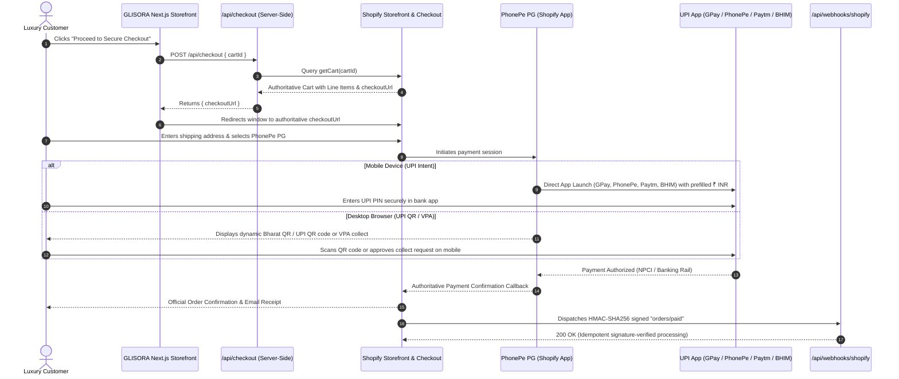

# GLISORA — Secure Payment Gateway & UPI Integration Guide (Without Razorpay)

**Brand**: GLISORA (*Comfort. Style. Everyday.*)  
**Target Market**: India (INR ₹)  
**Approved Primary Gateway**: **PhonePe Payment Gateway (Official Shopify Payment App)**  
**Approved Secondary Gateway**: **Paytm Payment Gateway**  
**Supported Payment Methods**: Google Pay (GPay), PhonePe, Paytm, BHIM UPI, RuPay / Visa / Mastercard, Net Banking  

---

## 1. Executive Summary & Architecture

GLISORA utilizes an authoritative **Headless Next.js + Shopify Storefront API + PhonePe Payment Gateway** architecture.



### Key Architectural Tenets
1. **Zero Client-Side Trust**: Product prices, tax calculations, variant availability, and totals are computed authoritatively by Shopify. Client-submitted prices are never accepted.
2. **Zero-Knowledge Security**: Customer UPI PINs, OTPs, card CVVs, and net banking passwords never touch the Next.js server. Payments are authorized inside the customer's secure bank/UPI app.
3. **No Fake Success Pages**: Orders are marked paid solely through authoritative Shopify / PhonePe server-to-server callbacks and verified webhooks.

---

## 2. Why PhonePe Payment Gateway is the Preferred Non-Razorpay Gateway

| Feature | PhonePe Payment Gateway | Paytm Payment Gateway | Direct Bank Acquirer (HDFC/ICICI) |
| :--- | :--- | :--- | :--- |
| **Official Shopify App** | **Yes (Certified Shopify App)** | Yes | No (Requires Custom Middleware) |
| **UPI Intent (GPay/PhonePe/Paytm)** | **Yes (Direct Mobile App Launch)** | Yes | Complex native SDK needed |
| **Desktop UPI QR** | **Yes (Dynamic Bharat QR)** | Yes | Requires custom QR generation |
| **RuPay & Cards** | **Yes (Credit/Debit/Corporate)** | Yes | Yes |
| **Net Banking** | **Yes (50+ Indian Banks)** | Yes | Yes |
| **Merchant Transaction Fee** | Competitive standard MDR | Standard MDR | Custom enterprise pricing |
| **Integration Complexity** | **Zero Code (Shopify Native)** | Zero Code (Shopify Native) | High development overhead |

**Conclusion**: PhonePe Payment Gateway provides the smoothest UPI conversion rates in India, direct deep-link intent for all major UPI apps (including Google Pay, PhonePe, and Paytm), and installs natively via the Shopify Admin without requiring any custom payment code or Razorpay dependencies.

---

## 3. Step-by-Step PhonePe Business Onboarding

To accept live customer payments, you must establish an active merchant profile with PhonePe:

1. **Register Merchant Account**:
   - Visit the official portal: [https://business.phonepe.com/](https://business.phonepe.com/)
   - Sign up using your business mobile number and email.
2. **Submit Business KYC**:
   - **Business Type**: Private Limited, Partnership, LLP, or Sole Proprietorship.
   - **Entity Documents**: Certificate of Incorporation / Registration Certificate, GSTIN Certificate, Company PAN Card.
   - **Banking Details**: Cancelled cheque or bank statement showing business legal name and IFSC code.
   - **Authorized Signatory**: PAN card and Aadhaar of director/proprietor.
3. **Account Activation**:
   - PhonePe compliance verifies documents (typically 24–48 business hours).
   - Once approved, access the **PhonePe Merchant Dashboard** to view your active status.

---

## 4. Exact Shopify Admin Installation Steps

Once your PhonePe business profile is active, connect it to your Shopify store:

1. Log in to your **Shopify Admin** (`https://admin.shopify.com/store/your-store`).
2. Navigate to **Settings** (bottom left) > **Payments**.
3. Under **Supported payment methods**, click **Add payment method**.
4. Select **Search by provider** and enter:
   ```text
   PhonePe PG
   ```
5. Click **Install** next to PhonePe Payment Gateway.
6. Shopify will display the app permissions screen. Click **Install App** to confirm.
7. You will be redirected to the PhonePe Merchant portal:
   - Log in with your registered PhonePe Business credentials.
   - Authorize the connection to your Shopify store.
8. Once redirected back to Shopify Admin:
   - Ensure the payment method label is set to:
     ```text
     PhonePe - UPI (GPay, PhonePe, Paytm), Cards & NetBanking
     ```
   - Click **Activate PhonePe PG**.

---

## 5. Alternative Approved Provider: Paytm Payment Gateway

If your business already holds an active Paytm for Business merchant account:

1. In **Shopify Admin** > **Settings** > **Payments**.
2. Click **Add payment method** > **Search by provider** > **Paytm Payment Gateway**.
3. Click **Install** and log in to your Paytm Merchant Dashboard.
4. Paste your **Merchant ID (MID)** and **Merchant Key** (retrieved from Paytm Dashboard > API Keys).
5. Click **Activate**.

---

## 6. Analysis: Direct Bank-Acquirer UPI (e.g. HDFC SmartGateway / ICICI)

Merchants occasionally ask whether they can connect directly to a bank acquirer (e.g., HDFC SmartGateway or ICICI PayDirect) rather than PhonePe:

- **Merchant Onboarding Requirements**:
  - Direct commercial agreement with the bank's merchant acquiring division.
  - Requires maintaining a corporate current/nodal account with the bank and minimum quarterly GMV thresholds (typically ₹25L–₹1Cr+).
- **Shopify Platform Limitation**:
  - Shopify's PCI-DSS Level 1 checkout architecture prohibits injecting arbitrary third-party payment scripts or direct bank APIs into the checkout flow unless the provider is an officially certified **Shopify Hosted Payment Partner**.
  - Connecting directly to bank acquirers on Shopify requires enterprise Shopify Plus and building an official Shopify Payments App using the Shopify Payments Apps API.
- **Recommendation**:
  - Using **PhonePe Payment Gateway** (or Paytm) on Shopify provides identical bank-grade security, instant settlement, and full UPI coverage without the enterprise overhead.

---

## 7. Sandbox Testing & Verification Guide

### A. Testing PhonePe in Test / Staging Mode
1. In Shopify Admin > **Settings** > **Payments** > Click **Manage** on PhonePe PG.
2. Check the **Enable test mode** checkbox.
3. On your GLISORA storefront:
   - Add a luxury garment to your bag.
   - Click **Proceed to Secure Checkout**.
   - You will be redirected to Shopify's secure checkout.
   - Select PhonePe PG.
   - Test the flow using PhonePe's staging test UPI handle (or ₹1 live micro-transaction).
4. Verify:
   - Order appears in Shopify Admin > **Orders** with status **Paid**.
   - Customer receives automated order confirmation.
   - Incomplete / cancelled payments show as **Unpaid** or **Abandoned**.

> [!IMPORTANT]
> Always uncheck **Enable test mode** in Shopify Admin before launching your live store to real customers.

---

## 8. Webhook Configuration & Signature Verification

GLISORA includes a production-grade, HMAC-SHA256 signature-verified webhook handler at:
```text
POST https://www.glisora.com/api/webhooks/shopify
```

### Steps to Configure in Shopify Admin:
1. Go to **Settings** > **Notifications** > scroll down to **Webhooks**.
2. Click **Create Webhook**:
   - **Event**: `Order payment` (topic: `orders/paid`)
   - **Format**: `JSON`
   - **URL**: `https://your-domain.com/api/webhooks/shopify`
   - **Webhook API version**: `2025-01` (Latest stable)
3. Click **Save**.
4. Scroll to the bottom of the Webhooks section and copy the **Webhook signing secret**.
5. Paste this secret into your `.env.local` file:
   ```env
   SHOPIFY_WEBHOOK_SECRET=your_copied_secret_here
   ```

### Webhook Features Implemented in GLISORA:
- **Cryptographic Verification**: Verifies `x-shopify-hmac-sha256` using timing-safe buffer comparison to prevent timing attacks.
- **Idempotency Protection**: In-memory cache tracks `x-shopify-webhook-id` to prevent duplicate processing of re-sent webhooks.
- **Gateway Tracking**: Logs payment gateway (`PhonePe`, `Paytm`), order reference, and amount in INR.

---

## 9. Environment Variables Checklist

Add these to your `.env.local` file:

```env
# ------------------------------------------------------------------------------
# SHOPIFY STOREFRONT CREDENTIALS
# ------------------------------------------------------------------------------
SHOPIFY_STORE_DOMAIN=your-store.myshopify.com
SHOPIFY_STOREFRONT_ACCESS_TOKEN=your_headless_storefront_token
SHOPIFY_API_VERSION=2025-01

# ------------------------------------------------------------------------------
# PUBLIC SITE CONFIGURATION
# ------------------------------------------------------------------------------
NEXT_PUBLIC_SITE_URL=https://www.glisora.com

# ------------------------------------------------------------------------------
# SHOPIFY WEBHOOK SIGNING SECRET
# ------------------------------------------------------------------------------
SHOPIFY_WEBHOOK_SECRET=your_shopify_webhook_secret_from_admin
```

*(Note: PhonePe Merchant ID and Salt Keys are configured directly in Shopify Admin Payments and never exposed in Next.js code).*

---

## 10. Security & RBI Compliance Checklist

- [x] **No Card Data / CVV Stored**: Compliant with RBI card-on-file tokenization guidelines.
- [x] **No UPI PINs / OTPs Collected**: Customer enters UPI PIN strictly inside their personal UPI app.
- [x] **No Plaintext Secrets in Frontend**: All API tokens remain strictly server-side.
- [x] **HMAC-SHA256 Webhook Verification**: Prevents forged payment notices.
- [x] **Idempotency Protection**: Eliminates duplicate order creation.
- [x] **PCI-DSS Level 1 Hosted Checkout**: Shopify manages checkout security, encryption, and compliance.
